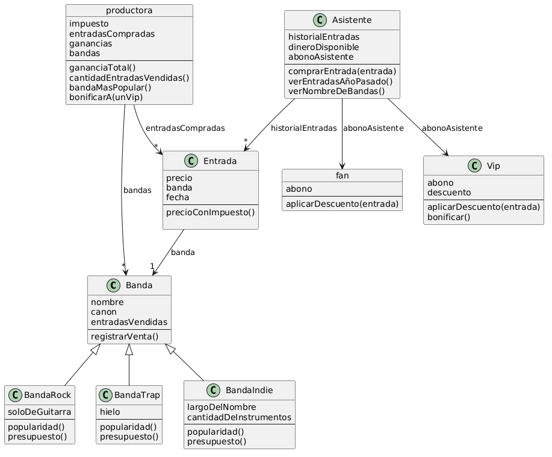

## 5 Conceptos Vistos en la Materia

1. Encapsulamiento: A la hora de trabajar con el descuento de los Vips, el valor del descuento dice el enunciado que es particular para cada asistente. Pero la productora debe poder modificar el descuento de los vips. Como el atributo es del Vip, y un objeto por fuera no debe poder modificar los valores del objeto (que son propios del objeto y privados), se arma el mensaje "bonificar()" para que pueda mandarle ese mensaje el objeto productora y así modificarlo por otro objeto.

2. Clases y Herencia: Al tener que generar distintos tipos de bandas, sabemos que tienen atributos en común a todas las bandas (por ejemplo que todas tienen un nombre o un canon especifico), pero sumado a eso, cada banda que genera objetos tiene sus propios atributos que se repiten, por lo que decidi armar una Clase Banda general que cumple con todas las bandas, y despues creé clases especificas de cada tipo de banda que hereden los valores de la clase general Banda (la cual es llamada SuperClase). Cada una de ellas tiene sus propios atributos y respuesta a los mensajes, por lo que lo ideal es el uso de las Clases y la herencia.

3. Well-Known Object: Hay objetos que necesitan ser conocidos por todo el sistema y no se van a instanciar mas de un objeto con sus caracteristicas, por lo que lo definimos como un objeto bien conocido (en este caso, a la productora) permitiendo que interactue con todos los otros objetos del sistema. Gracias a esto, es posible que maneje los impuestos de las entradas, diga las bandas mas populares o maneje la bonificación de los vips, estando inmerso en la vida de los demas objetos (o clases que generen objetos específicos).

4. Bloques y Colecciones: Como se trabaja con colecciones de elementos (ya sea por ejemplo en el historial de las entradas compradas por los asistentes), es necesario poder recorrerlas para trabajar con ellas, ya sea añadiendole datos (causandoles un efecto) o buscando un valor de retorno para verificar algo (utilizando funciones que no causan efecto) para el manejo o impresión de sus valores internos. Para recorrer cada valor, se utilizan los bloques que permiten generar objetos de uso unico dentro del metodo (como si fueran objetos descartables).

5. Polimorfismo: Todas las bandas, indistintamente de que tipo de banda sea o que atributos tenga, deben poder responder a los mismos mensajes. Asi es el uso del polimorfismo, para que el usuario pueda enviar los mensajes indistintamente de cada objeto, permitiendo comunicarse con todos sin la necesidad de saber con que objeto se esta trabajando. Esto permite que los otros objetos (por ejemplo cuando la productora maneja los presupuestos para restarlos de la ganancia total) puedan comunicarse con todos los objetos que son del tipo banda, ya que todos manejan el mismo mensaje "presupuesto()" con la misma cantidad de parametros dentro.

## Aclaraciones de conceptos utilizados en el código
Se utilizo herencia en las bandas porque el propio enunciado menciona que todas las bandas tienen nombre y canon, pero despues comenta que hay varias bandas que pueden ser de distintos generos, entonces esto permite ver 2 cosas: Que va a haber una clase general banda, pero que tambien va a haber una clase particular de cada banda que genere objetos específicos, por eso heredan lo de la clase superior, manteniendo sus propios atributos específicos.

Al decir que el abono de vip es distinto dependiendo el caso, formula tambien el uso de las clases porque cada asistente que sea vip va a tener un descuento propio, por lo que es un comportamiento repetitivo pero que varia dependiendo el objeto. El abono "Fan" por otro lado se modela como objeto ya que su comportamiento es unico y repetitivo, no varia segun objeto.

Se tomo la decisión del manejo de las fechas de las entradas por medio de un calendario, para que se pueda tener siempre presente cual es el año actual, y asi manejar el año anterior justo con la resta entre años para que de 1 el resultado. Esto puede traer problemas para las compras del 2026 contando el año 2026, pero se toma como venta "del año anterior" a todas las compras del 2025, no se toman como compras de 1 año las que son el mismo año en curso.

## Diagrama de Clases del TP

